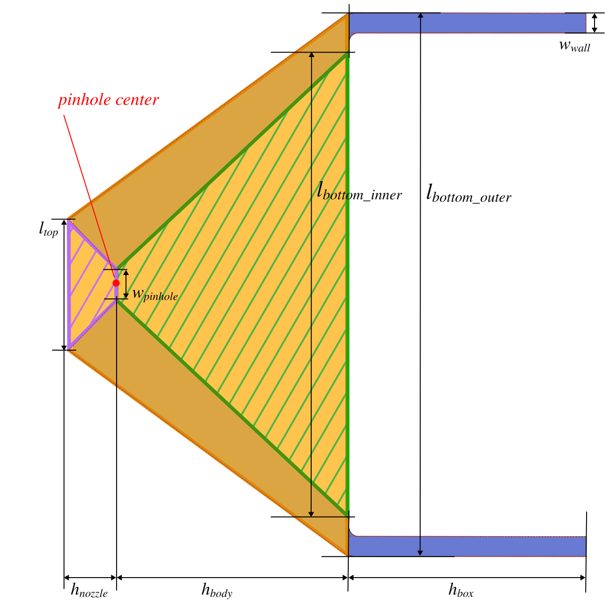

## Mark's 3D Illustration of the Brain SPECT System

::: {.content-visible when-format="html"}
{#fig-marks-whole-3d}
:::

::: {.content-visible when-format="typst"}
{#fig-marks-whole-3d width="4.5in"}
:::

## Brain SPECT Design Diagram of a Single Collimator for Simulation

::: {.content-visible when-format="html"}
{#fig-simulation-diagram width="60%" height="60%" fig-style="object-fit: contain;"}
:::

::: {.content-visible when-format="typst"}
{#fig-simulation-diagram width="4in"}
:::

```{python}
#| echo: false
#| label: tbl-geometry
#| tbl-cap: "Geometry Parameters. Here we assume a fixed RoI (FOV) of 210 mm in diameter. The designed (ideal) distance from pinhole to RoI center varies with respect to the pinhole size."
#| tbl-colwidths: [12, 8, 10, 13, 9, 15, 15, 8, 8]  # Adjust these percentages!
#| tbl-align: center
#| 
import pandas as pd
from IPython.display import Markdown

# 1. Define the data
variable_data = [
    [0.556, 5.04, 10.74, 149.61],
    [0.750, 5.03, 10.95, 150.01],
    [0.797, 5.02, 11.00, 150.10],
    [1.000, 5.01, 11.23, 150.53],
    [1.215, 5.00, 11.46, 150.98],
    [1.500, 4.99, 11.78, 151.58],
    [2.000, 4.96, 12.33, 152.66],
    [2.007, 4.96, 12.33, 152.67],
    [2.500, 4.94, 12.87, 153.77],
    [3.000, 4.92, 13.42, 154.90],
]

constant_data = [2.03, 50.0, 56.064, 25.0, 23.5]

# Combine rows seamlessly (including the empty first column)
all_rows = [var_row + constant_data for var_row in variable_data]

# 2. Define the final LaTeX headers directly
headers = [
    "$w_{\\textit{pinhole}}$",
    "$h_{\\textit{nozzle}}$",
    "$l_{\\textit{top}}$",
    "$d_{\\textit{pinhole}}$",
    "$w_{\\textit{wall}}$",
    "$l_{\\textit{bottom\\_inner}}$",
    "$l_{\\textit{bottom\\_outer}}$",
    "$h_{\\textit{body}}$",
    "$h_{\\textit{box}}$",
]

df = pd.DataFrame(all_rows, columns=headers)

# 3. Format and Output
# Define decimal places left-to-right (first item is empty for the text column)
formats = [".3f", ".2f", ".2f", ".2f", ".2f", ".1f", ".3f", ".1f", ".1f"]

Markdown(df.to_markdown(index=False, floatfmt=formats))
```

We will simulate for pinhole sizes:

- 0.556
- 0.797
- 1.215
- 2.007

## Brain SPECT Visualization for GATE 10 Simulation

The following visualization is based on the pinhole size $w_{pinhole} = 0.556\, mm$, which is the first row.

::: {.content-visible when-format="html"}
<style>
  /* Add a border to the right side of the 4th column (d_pinhole) */
  #tbl-geometry td:nth-child(4), 
  #tbl-geometry th:nth-child(4) {
    border-right: 1px solid #303030;
  }
</style>

<iframe src="python/jupyter/brain_spect_geometry.html" width="100%" height="500px" style="border:none;"></iframe>
:::

::: {#fig-collimator-proj layout-ncol=3 .content-visible when-format="html"}
{#fig-collimator-proj-x}

{#fig-collimator-proj-y}

{#fig-collimator-proj-z}

Collimator Projection three-view projections
:::


::: {#fig-collimator-proj layout-ncol=3 .content-visible when-format="typst"}

{#fig-collimator-proj-x height="2in"}

{#fig-collimator-proj-y height="2in"}

{#fig-collimator-proj-z height="2in"}

Collimator Projection three-view projections
:::


::: {.callout-note}
There is no fillet/round or chamfer for the geometries in the simulation
:::

The collimator in the simulation is created by subtracting the green frustum and the magenta frustum from the orange frustum. Then the hollow frustum is combined with the box sheilding through a Boolean union operation.


## Mark's Design Diagrams of a Single Collimator

\

The following design are provided by Mark and correspond to version number 008.


::: {.content-visible when-format="html"}
{#fig-marks-diagram-01 width="80%" height="80%" fig-style="object-fit: contain;"}
:::

::: {.content-visible when-format="typst"}
{#fig-marks-diagram-01 width="4.5in"}
:::


::: {#fig-marks-3d-collimator layout-ncol=2 .content-visible when-format="html"}
{#fig-marks-3d-collimator-front width="50%" height="50%" fig-style="object-fit: contain;"}

{#fig-marks-3d-collimator-back  width="50%" height="50%" fig-style="object-fit: contain;"}

Mark's 3D Design Visualization
:::


::: {#fig-marks-3d-collimator layout-ncol=2 .content-visible when-format="typst"}
{#fig-marks-3d-collimator-front height="2in"}

{#fig-marks-3d-collimator-back height="2in"}

Mark's 3D Design Visualization
:::